# ACA -- Programación Avanzada

# Sistema de Gestión de Biblioteca

------------------------------------------------------------------------

## PORTADA

**\[Universidad Cundinamarca\]**

**\[PROGRAMACION AVANZADA/54465/SEGUNDO BLOQUE/26V04\]**

### ACA -- Programación Avanzada

### Sistema de Gestión de Biblioteca

**Presentado por:**\
\[Kevin Enderson Ramirez Moreno\]

**Docente:**\
\[Veronica Castro Munar\]

**Fecha:**\
\[Bogota/8/11/2026\]

------------------------------------------------------------------------
------------------------------------------------------------------------

## CONTRAPORTADA

**\[Universidad Cundinamarca\]**

**\[PROGRAMACION AVANZADA/54465/SEGUNDO BLOQUE/26V04\]**

### ACA -- Programación Avanzada

### Sistema de Gestión de Biblioteca
**Presentado por:**\
\[Kevin Enderson Ramirez Moreno\]

**Docente:**\
\[Veronica Castro Munar\]

**Fecha:**\
\[Bogota/8/11/2026\]


------------------------------------------------------------------------

# TABLA DE CONTENIDO

1.  Introducción
2.  Objetivos
    -   2.1 Objetivo general
    -   2.2 Objetivos específicos
3.  Planteamiento del problema
4.  Análisis de requerimientos
5.  Casos de uso
6.  Diagrama de clases
7.  Modelo entidad-relación
8.  Diccionario de datos
9.  Arquitectura del sistema
10. Explicación de los módulos desarrollados
11. Capturas de pantalla del sistema
12. Pruebas de funcionamiento
13. Conclusiones
14. Recomendaciones


------------------------------------------------------------------------

# 1. INTRODUCCIÓN
 
El presente documento describe el desarrollo del **Sistema de Gestión de Biblioteca (AcaBiblioteca)**, una aplicación de escritorio cuyo propósito es facilitar la administración de los procesos básicos de una biblioteca institucional: el registro y consulta de libros, autores, editoriales y usuarios, el control de préstamos y devoluciones, y la generación de reportes, con el fin de centralizar la información y mantener su integridad y consistencia.
 
El sistema fue desarrollado con **C#, Windows Forms (.NET 10) y SQL Server**, utilizando ADO.NET (`Microsoft.Data.SqlClient`) para la comunicación con la base de datos **AcaBiblioteca**. La aplicación se organiza en un formulario principal con menú lateral que da acceso a los módulos de libros, autores, editoriales, usuarios, préstamos y reportes. Cada módulo es un formulario que implementa las operaciones de registro, consulta, actualización y eliminación (CRUD) mediante consultas parametrizadas, validación de datos y manejo de excepciones. La conexión a la base de datos se centraliza en la clase `Conexion`.
 
El desarrollo se documentó y versionó mediante Git y GitHub.
 
---
 
# 2. OBJETIVOS
 
## 2.1 Objetivo general
 
Desarrollar un Sistema de Gestión de Biblioteca mediante una aplicación de escritorio en C# con Windows Forms y una base de datos relacional en SQL Server, que permita administrar la información de libros, autores, editoriales y usuarios, controlar los préstamos y las devoluciones junto con las existencias de cada libro, y generar reportes que faciliten la gestión de los recursos bibliográficos.
 
## 2.2 Objetivos específicos
 
- Desarrollar los módulos de gestión de libros, autores, editoriales y usuarios, incorporando las operaciones de registro, consulta, actualización y eliminación (CRUD).
- Diseñar e implementar una base de datos relacional en SQL Server con cinco tablas (`Autores`, `Editoriales`, `Libros`, `Usuarios` y `Prestamos`), relacionadas mediante claves primarias, claves foráneas y restricciones de integridad.
- Implementar el registro de préstamos y devoluciones, actualizando las existencias de los libros mediante transacciones.
- Desarrollar tres reportes que permitan consultar los préstamos activos, los préstamos devueltos y el inventario de libros.
- Aplicar conceptos de Programación Orientada a Objetos y de desarrollo con Windows Forms: formularios como clases, eventos, encapsulamiento de la conexión en la clase `Conexion` y uso de objetos de ADO.NET.
- Incorporar validaciones de datos y manejo de excepciones (`try/catch`) para prevenir errores durante el ingreso, procesamiento y almacenamiento de la información.
- Utilizar consultas parametrizadas para evitar la inyección de SQL.
- Utilizar Git y GitHub para el control de versiones.
- Elaborar la documentación técnica y funcional del proyecto: diagramas, diccionario de datos, pruebas y evidencias.
---
 
# 3. PLANTEAMIENTO DEL PROBLEMA
 
## 3.1 Descripción del problema
 
La administración de una biblioteca requiere mantener organizada y actualizada la información de libros, autores, editoriales y usuarios, además de llevar un control adecuado de los préstamos y de las existencias disponibles. Cuando estos procesos se realizan de forma manual o con herramientas no integradas, pueden presentarse dificultades para consultar la información, controlar los ejemplares disponibles, identificar los préstamos activos y mantener la integridad de los registros.
 
Esta situación puede ocasionar inconsistencias en los datos, duplicidad de información, errores al registrar préstamos y dificultad para conocer el estado actual del inventario. Ante esta necesidad se plantea el desarrollo de **AcaBiblioteca**, una aplicación de escritorio conectada a una base de datos relacional que centraliza la información y facilita el control de los préstamos, las devoluciones y el inventario.
 
## 3.2 Justificación
 
El desarrollo de AcaBiblioteca surge de la necesidad de contar con una herramienta que facilite la administración de la información y de los procesos fundamentales de una biblioteca, reduciendo los problemas asociados al manejo desorganizado de los registros y al seguimiento de los préstamos y las existencias.
 
El sistema centraliza la información en una base de datos SQL Server, permite registrar, consultar, modificar y eliminar datos, controla los préstamos y las devoluciones actualizando las existencias, y genera reportes para el seguimiento del inventario.
 
Desde el punto de vista técnico y académico, el proyecto permite aplicar los conocimientos de Programación Avanzada: desarrollo de interfaces gráficas con C# y Windows Forms, gestión de bases de datos relacionales, operaciones CRUD, validación de información, transacciones y manejo de excepciones, así como el uso de Git y GitHub.
 
## 3.3 Alcance
 
El sistema permite:
 
- Gestionar libros (registrar, consultar, buscar por ISBN, actualizar y eliminar).
- Gestionar autores.
- Gestionar editoriales.
- Gestionar usuarios.
- Registrar préstamos, descontando una existencia del libro.
- Registrar devoluciones, reponiendo la existencia del libro.
- Eliminar préstamos, reponiendo la existencia cuando el préstamo estaba activo.
- Generar reportes de préstamos activos, préstamos devueltos e inventario de libros.
### Fuera del alcance
 
Las siguientes funcionalidades **no** forman parte de esta versión:
 
- Autenticación de usuarios y control de roles (la aplicación no tiene inicio de sesión).
- Gestión de categorías como entidad independiente: la categoría se almacena como un campo de texto del libro.
- Cálculo de fechas límite de devolución, días de retraso, préstamos vencidos y multas. El sistema solo registra la fecha del préstamo, la fecha de devolución y el estado («Prestado» o «Devuelto»).
- Préstamos de varios libros en un solo registro: cada préstamo corresponde a un único libro.
- Acceso a través de internet.
---
 
# 4. ANÁLISIS DE REQUERIMIENTOS
 
## 4.1 Descripción general
 
AcaBiblioteca es una aplicación de escritorio desarrollada en C# y Windows Forms, con conexión a una base de datos relacional en SQL Server. Su propósito es facilitar la administración de la información bibliográfica y el control de los préstamos. Permite administrar libros, autores, editoriales y usuarios mediante operaciones CRUD, registrar préstamos y devoluciones actualizando las existencias de los libros y consultar tres reportes: préstamos activos, préstamos devueltos e inventario de libros.
 
## 4.2 Actores del sistema
 
| Actor | Descripción |
|---|---|
| Bibliotecario / Administrador | Único actor del sistema. Opera la aplicación y administra libros, autores, editoriales y usuarios; registra préstamos y devoluciones, elimina préstamos y consulta los reportes. La aplicación no cuenta con autenticación propia. |
 
Los usuarios (lectores) **no** son actores: son registros de la base de datos que el bibliotecario crea y a los que asigna préstamos.
 
## 4.3 Requerimientos funcionales
 
| Código | Requerimiento | Descripción |
|---|---|---|
| RF01 | Gestionar libros | Registrar, consultar (listado), buscar por ISBN, actualizar y eliminar libros: ISBN, título, autor, editorial, categoría, año y existencias. |
| RF02 | Gestionar autores | Registrar, consultar, actualizar y eliminar autores (nombre y apellido). |
| RF03 | Gestionar editoriales | Registrar, consultar, actualizar y eliminar editoriales (nombre). |
| RF04 | Gestionar usuarios | Registrar, consultar, actualizar y eliminar usuarios: nombre, apellido, documento (único), teléfono y correo. |
| RF05 | Registrar préstamos | Asociar un usuario y un libro con la fecha del préstamo y el estado «Prestado». Descuenta una existencia del libro dentro de una transacción; si no hay existencias, rechaza el préstamo. |
| RF06 | Registrar devoluciones | Sobre un préstamo en estado «Prestado», registrar la fecha de devolución (no anterior a la del préstamo), cambiar el estado a «Devuelto» y reponer una existencia. |
| RF07 | Eliminar préstamos | Eliminar un préstamo; si estaba en estado «Prestado», repone la existencia del libro. |
| RF08 | Generar reportes | Consultar préstamos activos, préstamos devueltos e inventario de libros (con autor y editorial). |
 
## 4.4 Requerimientos no funcionales
 
| Código | Requerimiento | Descripción |
|---|---|---|
| RNF01 | Usabilidad | Interfaz con menú lateral (Inicio, Libros, Usuarios, Autores, Editoriales, Préstamos, Reportes y Salir); cada módulo se muestra dentro del panel principal. |
| RNF02 | Validación | El sistema valida los campos obligatorios y los valores numéricos (año y existencias) antes de guardar, y solicita confirmación antes de eliminar. |
| RNF03 | Mantenibilidad | Un formulario por módulo y conexión centralizada en la clase `Conexion`. |
| RNF04 | Manejo de excepciones | Las operaciones con la base de datos están dentro de bloques `try/catch` que informan el error al usuario mediante mensajes. |
| RNF05 | Integridad de datos | Claves primarias y foráneas, documento de usuario único y transacciones (`SqlTransaction`) en los préstamos y devoluciones. |
| RNF06 | Consultas parametrizadas | Las consultas utilizan parámetros (`@ISBN`, `@IdAutor`, etc.). |
| RNF07 | Respaldo | La base de datos puede restaurarse desde el archivo `AcaBiblioteca.bak`; el script `SQLQuery2.sql` crea las tablas y los datos de prueba. |
 
## 4.5 Reglas de negocio
 
### RN01 — ISBN único del libro
No se permite registrar dos libros con el mismo ISBN, ya que es la clave primaria de la tabla `Libros`. La base de datos rechaza el registro duplicado.
 
### RN02 — Datos obligatorios
No se permite guardar libros, autores, editoriales o usuarios con campos obligatorios vacíos, ni años o existencias que no sean números enteros.
 
### RN03 — Documento único
No pueden existir dos usuarios con el mismo documento (restricción `UNIQUE`).
 
### RN04 — Autor y editorial existentes
Para registrar un libro deben existir previamente el autor y la editorial; se seleccionan de listas desplegables y la base de datos exige las claves foráneas.
 
### RN05 — Disponibilidad
No se puede prestar un libro cuando no hay existencias («No hay existencias disponibles de este libro»).
 
### RN06 — Actualización al prestar
Al registrar un préstamo, las existencias del libro disminuyen en una unidad.
 
### RN07 — Devolución
Solo se puede devolver un préstamo en estado «Prestado». La fecha de devolución es obligatoria y no puede ser anterior a la fecha del préstamo. Al devolver, el estado pasa a «Devuelto» y las existencias aumentan en una unidad.
 
### RN08 — Eliminación de préstamos
Al eliminar un préstamo en estado «Prestado», se repone una existencia del libro; si ya estaba devuelto, las existencias no cambian.
 
---
 
# 5. CASOS DE USO
 
## 5.1 Descripción
 
El Bibliotecario / Administrador es el único actor de AcaBiblioteca. Su interacción con el sistema se desarrolla así:
 
- **Gestión de libros:** registra, consulta, busca por ISBN, modifica y elimina libros, y administra sus existencias.
- **Gestión de autores:** registra, consulta, actualiza y elimina autores.
- **Gestión de editoriales:** registra, consulta, actualiza y elimina editoriales.
- **Gestión de usuarios:** registra y mantiene actualizada la información de los usuarios (lectores).
- **Gestión de préstamos:** registra préstamos de libros a usuarios, registra su devolución, los elimina y consulta los préstamos realizados.
- **Generación de reportes:** consulta los préstamos activos, los préstamos devueltos y el inventario de libros.
## 5.2 Diagrama de casos de uso
 
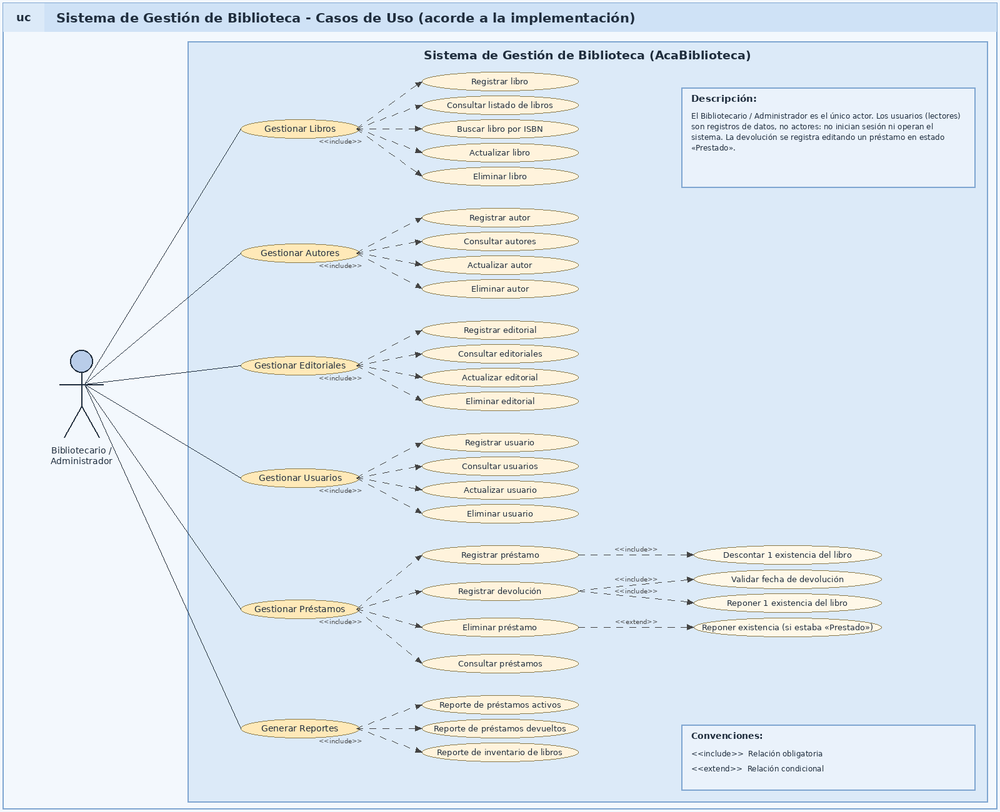


## 5.3 Descripción de casos de uso
 
El diagrama representa las funcionalidades implementadas: Gestionar libros, autores, editoriales, usuarios, préstamos y Generar reportes. Cada caso se descompone en operaciones específicas (registrar, consultar, actualizar, eliminar). Las operaciones de préstamos incluyen la actualización de existencias del libro.
 
### CU01 — Gestionar libros
 
**Actor principal:** Bibliotecario / Administrador
 
**Descripción:** Permite administrar los libros de la biblioteca: registro, consulta, búsqueda por ISBN, actualización y eliminación.
 
**Precondiciones:**
- La aplicación está en ejecución y la conexión con la base de datos está disponible.
- Para registrar un libro deben existir previamente el autor y la editorial.
**Flujo principal:**
1. El actor ingresa al módulo de libros desde el menú lateral.
2. El sistema muestra el formulario y el listado de libros existentes.
3. El actor ingresa ISBN, título, autor, editorial, categoría, año de publicación y existencias.
4. El sistema valida que los campos estén completos y que año y existencias sean números enteros.
5. El sistema almacena el libro mediante una consulta parametrizada.
6. El sistema muestra «Libro guardado correctamente» y actualiza el listado.
**Flujos alternativos:**
- Campos incompletos: se muestra «Complete todos los campos antes de guardar».
- Año o existencias no numéricos: se informa que deben ser números enteros.
- ISBN ya existente o autor/editorial inexistente: la base de datos rechaza la operación y el sistema muestra el mensaje de error.
- Búsqueda por ISBN: si existe, el libro se carga en el formulario; si no, se informa que no se encontró.
- Edición y eliminación: se seleccionan desde la tabla (doble clic); la eliminación solicita confirmación.
**Postcondiciones:** El libro queda registrado, actualizado o eliminado en la tabla `Libros`.
 
---
 
### CU02 — Registrar préstamo
 
**Actor principal:** Bibliotecario / Administrador
 
**Descripción:** Permite registrar el préstamo de un libro a un usuario.
 
**Precondiciones:**
- El usuario y el libro existen en la base de datos.
- El libro tiene al menos una existencia disponible.
**Flujo principal:**
1. El actor ingresa al módulo de préstamos.
2. Selecciona el usuario y el libro de las listas desplegables y la fecha del préstamo.
3. Presiona «Guardar».
4. El sistema inicia una transacción y descuenta una existencia del libro (solo si `Existencias > 0`).
5. El sistema inserta el préstamo con estado «Prestado» y sin fecha de devolución.
6. El sistema confirma la transacción y muestra «Préstamo registrado correctamente».
**Flujos alternativos:**
- No se seleccionó usuario o libro: «Seleccione un usuario y un libro antes de guardar».
- El libro no tiene existencias: «No hay existencias disponibles de este libro»; no se registra el préstamo.
- Error en la base de datos: la transacción se revierte y se muestra el error.
**Postcondiciones:** El préstamo queda registrado en estado «Prestado» y las existencias del libro disminuyen en una unidad.
 
---
 
### CU03 — Registrar devolución
 
**Actor principal:** Bibliotecario / Administrador
 
**Descripción:** Permite registrar la devolución de un libro prestado.
 
**Precondiciones:** Debe existir un préstamo en estado «Prestado».
 
**Flujo principal:**
1. El actor selecciona el préstamo en la tabla.
2. Indica la fecha de devolución.
3. Presiona «Editar»; el sistema valida la fecha y solicita confirmación.
4. El sistema, dentro de una transacción, cambia el estado a «Devuelto», guarda la fecha y suma una existencia al libro.
5. Se muestra «Devolución registrada correctamente».
**Flujos alternativos:**
- Préstamo ya devuelto: «Este préstamo ya fue devuelto».
- No se seleccionó la fecha de devolución: se solicita seleccionarla.
- Fecha anterior a la del préstamo: «La fecha de devolución no puede ser anterior a la fecha del préstamo».
**Postcondiciones:** El préstamo queda en estado «Devuelto» y la existencia del libro se repone.
 
---
 
### CU04 — Generar reportes
 
**Actor principal:** Bibliotecario / Administrador
 
**Descripción:** Permite consultar información resumida de la biblioteca.
 
**Flujo principal:**
1. El actor ingresa al módulo de reportes.
2. Selecciona el tipo de reporte: «Préstamos activos», «Préstamos devueltos» o «Inventario de libros».
3. Presiona «Generar» y el sistema muestra los resultados en una tabla.
**Flujos alternativos:** Si no se selecciona un tipo, se solicita seleccionarlo; si no hay datos, se informa «No existen registros para este reporte».
 
**Postcondiciones:** Se muestra el reporte solicitado.
 
---
 
# 6. DIAGRAMA DE CLASES
 

## 6.1 Descripción
 
El diagrama de clases representa las entidades del sistema (que corresponden a las tablas de la base de datos), la clase `Conexion` y los formularios de Windows Forms. La aplicación no define clases de modelo ni clases DAO: los formularios ejecutan directamente las consultas SQL a través de objetos de ADO.NET.
 
## 6.2 Diagrama de clases

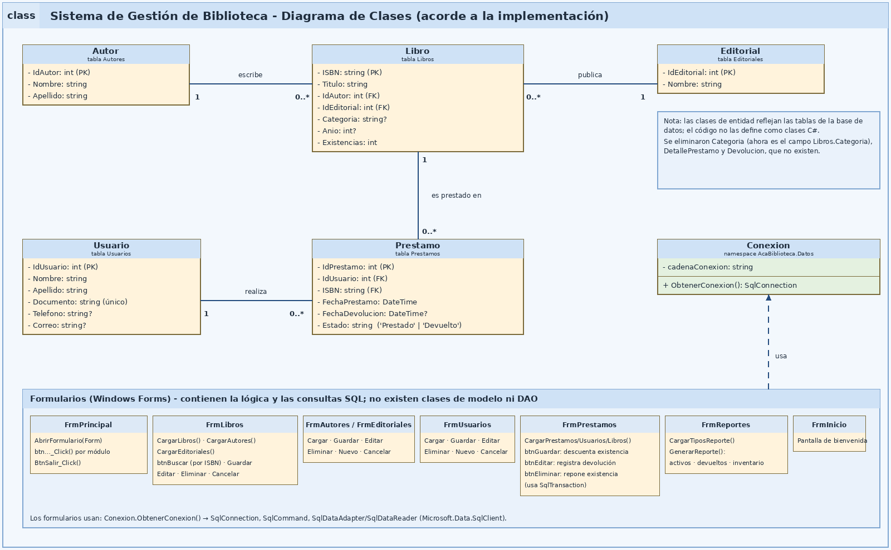

## 6.3 Principales clases
 
| Clase | Responsabilidad |
|---|---|
| Autor | Representa a los autores de los libros (tabla `Autores`). |
| Editorial | Representa a las editoriales (tabla `Editoriales`). |
| Libro | Representa los libros, identificados por su ISBN, con su categoría, año y existencias (tabla `Libros`). |
| Usuario | Representa a los usuarios de la biblioteca (tabla `Usuarios`). |
| Prestamo | Representa el préstamo de un libro a un usuario, con su estado y fechas (tabla `Prestamos`). |
| Conexion | Crea las conexiones a SQL Server mediante `ObtenerConexion()`. |
| FrmPrincipal | Formulario principal; abre los demás formularios dentro del panel de contenido. |
| FrmLibros, FrmAutores, FrmEditoriales, FrmUsuarios | Implementan el CRUD de cada entidad con validaciones. |
| FrmPrestamos | Registra préstamos y devoluciones y los elimina, actualizando existencias con transacciones. |
| FrmReportes | Genera los reportes de préstamos activos, devueltos e inventario. |
| FrmInicio | Pantalla de bienvenida. |
 
## 6.4 Aplicación de POO
 
- **Clases y objetos:** cada formulario es una clase que hereda de `Form`; `Conexion` es una clase propia; se crean objetos como `SqlConnection`, `SqlCommand`, `SqlDataAdapter` y `SqlTransaction`.
- **Herencia:** los formularios heredan de `Form` (Windows Forms) y se utilizan clases parciales (`partial class`) para separar el diseño de la lógica.
- **Encapsulamiento:** la cadena de conexión es un atributo privado de `Conexion`, que expone solo el método `ObtenerConexion()`.
- **Métodos y eventos:** cada acción de la interfaz se implementa en un método manejador de eventos (por ejemplo, `btnGuardar_Click`).
- **Colecciones y datos:** se utilizan `DataTable` y `DataGridView` para mostrar y manipular los datos.
- **Polimorfismo / sobrecarga:** no se implementaron de forma explícita en esta versión.
---
 
# 7. MODELO ENTIDAD-RELACIÓN
 
## 7.1 Descripción
 
El modelo de datos está formado por cinco tablas: `Autores`, `Editoriales`, `Libros`, `Usuarios` y `Prestamos`. Los libros referencian a su autor y a su editorial; los préstamos referencian al usuario y al libro prestado.
 
## 7.2 Diagrama entidad-relación
 

 
## 7.3 Relaciones principales
 
- Un autor puede tener muchos libros; cada libro tiene un único autor (`FK_Libros_Autores`).
- Una editorial puede publicar muchos libros; cada libro tiene una única editorial (`FK_Libros_Editoriales`).
- Un usuario puede tener muchos préstamos; cada préstamo pertenece a un usuario (`FK_Prestamos_Usuarios`).
- Un libro puede aparecer en muchos préstamos; cada préstamo corresponde a un único libro (`FK_Prestamos_Libros`).
---
 
# 8. DICCIONARIO DE DATOS
 
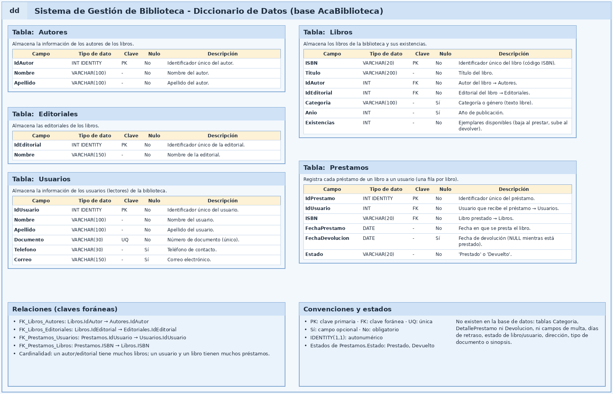
 
## 8.1 Convenciones
 
| Abreviatura | Significado |
|---|---|
| PK | Clave primaria |
| FK | Clave foránea |
| UQ | Campo con valor único |
| NULL | Campo que puede estar vacío |
| NOT NULL | Campo obligatorio |
 
## 8.2 Tabla: Autores
 
| Campo | Tipo de dato | Clave | Nulo | Descripción |
|---|---|---|---|---|
| IdAutor | INT IDENTITY(1,1) | PK | No | Identificador único del autor. |
| Nombre | VARCHAR(100) | - | No | Nombre del autor. |
| Apellido | VARCHAR(100) | - | No | Apellido del autor. |
 
## 8.3 Tabla: Editoriales
 
| Campo | Tipo de dato | Clave | Nulo | Descripción |
|---|---|---|---|---|
| IdEditorial | INT IDENTITY(1,1) | PK | No | Identificador único de la editorial. |
| Nombre | VARCHAR(150) | - | No | Nombre de la editorial. |
 
## 8.4 Tabla: Libros
 
| Campo | Tipo de dato | Clave | Nulo | Descripción |
|---|---|---|---|---|
| ISBN | VARCHAR(20) | PK | No | Identificador único del libro. |
| Titulo | VARCHAR(200) | - | No | Título del libro. |
| IdAutor | INT | FK | No | Autor del libro (→ Autores). |
| IdEditorial | INT | FK | No | Editorial del libro (→ Editoriales). |
| Categoria | VARCHAR(100) | - | Sí | Categoría o género (texto libre). |
| Anio | INT | - | Sí | Año de publicación. |
| Existencias | INT | - | No | Ejemplares disponibles. |
 
## 8.5 Tabla: Usuarios
 
| Campo | Tipo de dato | Clave | Nulo | Descripción |
|---|---|---|---|---|
| IdUsuario | INT IDENTITY(1,1) | PK | No | Identificador único del usuario. |
| Nombre | VARCHAR(100) | - | No | Nombre del usuario. |
| Apellido | VARCHAR(100) | - | No | Apellido del usuario. |
| Documento | VARCHAR(30) | UQ | No | Número de documento. |
| Telefono | VARCHAR(30) | - | Sí | Teléfono de contacto. |
| Correo | VARCHAR(150) | - | Sí | Correo electrónico. |
 
## 8.6 Tabla: Prestamos
 
| Campo | Tipo de dato | Clave | Nulo | Descripción |
|---|---|---|---|---|
| IdPrestamo | INT IDENTITY(1,1) | PK | No | Identificador único del préstamo. |
| IdUsuario | INT | FK | No | Usuario que recibe el préstamo (→ Usuarios). |
| ISBN | VARCHAR(20) | FK | No | Libro prestado (→ Libros). |
| FechaPrestamo | DATE | - | No | Fecha del préstamo. |
| FechaDevolucion | DATE | - | Sí | Fecha de devolución; es NULL mientras el libro está prestado. |
| Estado | VARCHAR(20) | - | No | Estado del préstamo: «Prestado» o «Devuelto». |
 
---
 
# 9. ARQUITECTURA DEL SISTEMA
 
## 9.1 Descripción general
 
AcaBiblioteca es una aplicación de escritorio cliente-servidor. La aplicación Windows Forms se ejecuta en el equipo del usuario y se conecta mediante la red a un servidor SQL Server que aloja la base de datos `AcaBiblioteca`. Internamente se distinguen tres niveles:
 
1. **Presentación y lógica (formularios Windows Forms):** interfaz gráfica, validaciones, reglas de préstamos y consultas SQL.
2. **Acceso a datos (clase `Conexion` y ADO.NET):** creación de conexiones y ejecución de comandos y transacciones.
3. **Base de datos (SQL Server).**
La aplicación no cuenta con clases separadas de lógica de negocio ni DAO: las reglas de negocio se implementan en los formularios.
 
## 9.2 Diagrama de arquitectura
 
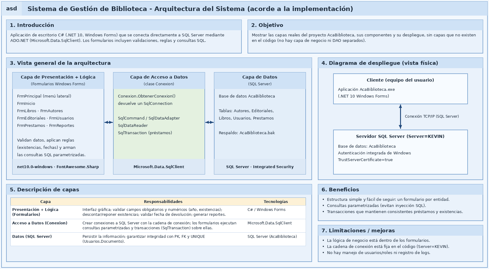
 
## 9.3 Presentación y lógica
 
**Responsabilidad:** permitir la interacción del usuario, validar los datos, aplicar las reglas (existencias, fechas de devolución) y construir las consultas parametrizadas.
 
**Componentes:** `FrmPrincipal`, `FrmInicio`, `FrmLibros`, `FrmAutores`, `FrmEditoriales`, `FrmUsuarios`, `FrmPrestamos` y `FrmReportes`.
 
**Tecnología:** C#, Windows Forms, .NET 10 (`net10.0-windows`) y la librería FontAwesome.Sharp para los iconos.
 
## 9.4 Acceso a datos
 
**Responsabilidad:** gestionar la comunicación entre la aplicación y SQL Server.
 
**Componentes:** clase `Conexion` (`AcaBiblioteca.Datos`), con el método `ObtenerConexion()` que devuelve un `SqlConnection`. Los formularios usan `SqlCommand`, `SqlDataAdapter`, `SqlDataReader` y `SqlTransaction`.
 
**Tecnologías:** ADO.NET con `Microsoft.Data.SqlClient` y consultas parametrizadas.
 
## 9.5 Base de datos
 
**Base de datos:** `AcaBiblioteca` (SQL Server, autenticación integrada de Windows).
 
**Tablas:** `Autores`, `Editoriales`, `Libros`, `Usuarios` y `Prestamos`.
 
## 9.6 Flujo de información
 
```text
Usuario
   ↓
Formulario (validación y reglas)
   ↓
Conexion / ADO.NET
   ↓
SQL Server
```
 
Las respuestas de la base de datos realizan el recorrido inverso hasta mostrarse en la interfaz.
 
## 9.7 Limitaciones y mejoras
 
- La lógica de negocio está dentro de los formularios; una mejora sería separarla en una capa propia y crear clases de acceso a datos.
- La cadena de conexión está fija en `Conexion.cs` (`Server=KEVIN`); debería moverse a un archivo de configuración.
- No existe autenticación ni registro de logs.
---
 
# 10. EXPLICACIÓN DE CADA MÓDULO DESARROLLADO
 
## 10.1 Módulo de libros (`FrmLibros`)
 
**Objetivo:** administrar el catálogo de libros y sus existencias.
 
**Funcionalidades:** registrar, consultar (listado), buscar por ISBN, actualizar y eliminar.
 
**Validaciones:** todos los campos son obligatorios; año y existencias deben ser números enteros; autor y editorial se eligen de listas; el ISBN no puede repetirse; la eliminación solicita confirmación.
 
## 10.2 Módulo de autores (`FrmAutores`)
 
**Objetivo:** administrar los autores de los libros.
 
**Funcionalidades:** registrar, consultar, actualizar y eliminar.
 
**Validaciones:** nombre y apellido obligatorios; debe seleccionarse un autor de la tabla para editar o eliminar; la eliminación solicita confirmación y la base de datos impide borrar autores con libros asociados.
 
## 10.3 Módulo de editoriales (`FrmEditoriales`)
 
**Objetivo:** administrar las editoriales.
 
**Funcionalidades:** registrar, consultar, actualizar y eliminar.
 
**Validaciones:** el nombre es obligatorio; la eliminación solicita confirmación y se informa cuando no es posible eliminarla.
 
## 10.4 Módulo de usuarios (`FrmUsuarios`)
 
**Objetivo:** administrar los usuarios (lectores) de la biblioteca.
 
**Funcionalidades:** registrar, consultar, actualizar y eliminar.
 
**Validaciones:** campos obligatorios; el documento debe ser único; la eliminación solicita confirmación.
 
## 10.5 Módulo de préstamos (`FrmPrestamos`)
 
**Objetivo:** controlar los préstamos y las devoluciones de libros.
 
**Funcionalidades:**
- Registrar préstamo: descuenta una existencia y crea el préstamo en estado «Prestado» (transacción).
- Registrar devolución: valida la fecha, cambia el estado a «Devuelto» y repone la existencia (transacción).
- Eliminar préstamo: repone la existencia si estaba «Prestado» (transacción).
- Consultar el listado de préstamos.
**Validaciones:** usuario y libro obligatorios; existencias disponibles; el préstamo no debe estar ya devuelto; fecha de devolución obligatoria y no anterior a la del préstamo.
 
## 10.6 Módulo de reportes (`FrmReportes`)
 
**Consultas implementadas:**
- Préstamos activos (estado «Prestado»), con usuario, libro y fecha de préstamo.
- Préstamos devueltos (estado «Devuelto»), con fechas de préstamo y devolución.
- Inventario de libros, con ISBN, título, autor, editorial, categoría, año y existencias.
---
 
# 11. CAPTURAS DE PANTALLA DEL SISTEMA
 

 
## 11.1 Menú principal
 
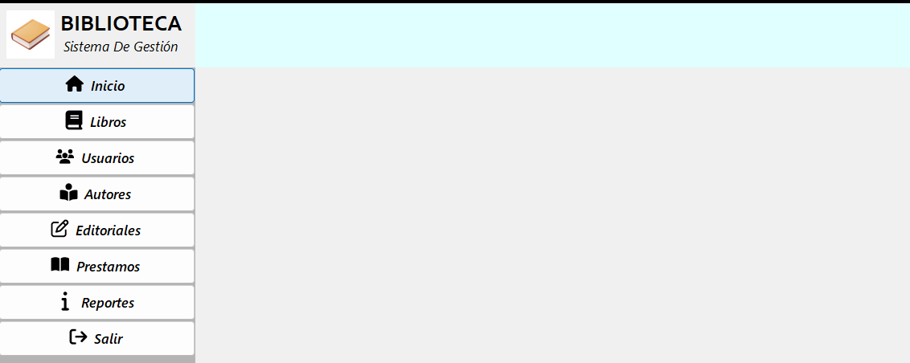
 
**Descripción:** Formulario principal con el menú lateral (Inicio, Libros, Usuarios, Autores, Editoriales, Préstamos, Reportes y Salir) y el panel donde se muestran los módulos.
 
## 11.2 Gestión de libros
 
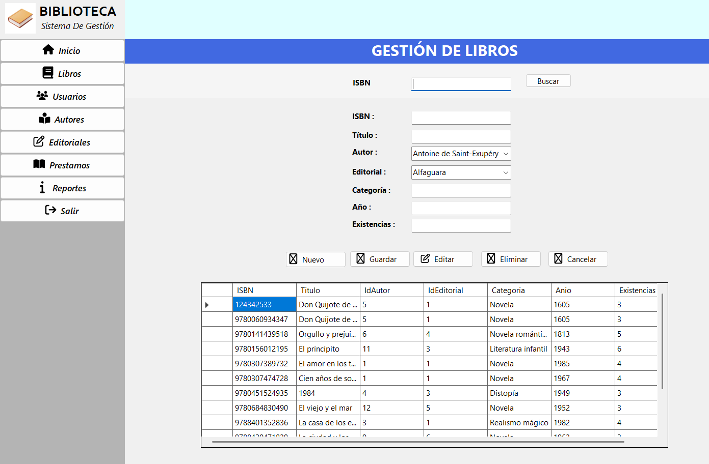
 
**Descripción:** Registro, búsqueda por ISBN, edición y eliminación de libros.
 
## 11.3 Gestión de autores
 
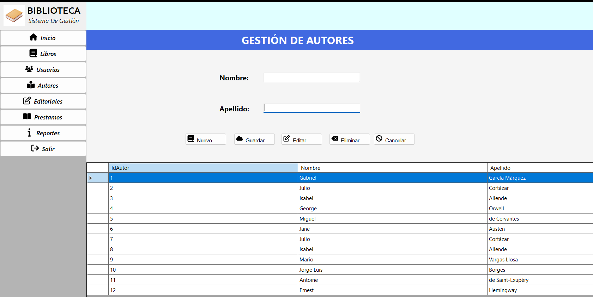
 
**Descripción:** CRUD de autores.
 
## 11.4 Gestión de editoriales
 
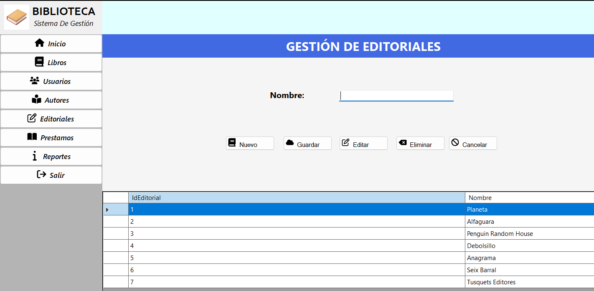
 
**Descripción:** CRUD de editoriales.
 
## 11.5 Gestión de usuarios
 
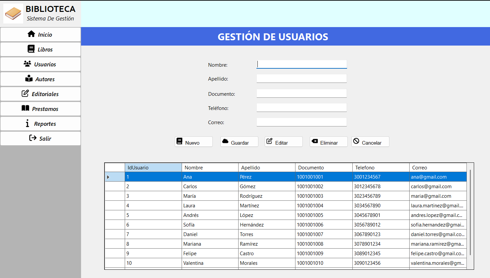
 
**Descripción:** CRUD de usuarios.
 
## 11.6 Registro de préstamos y devoluciones
 
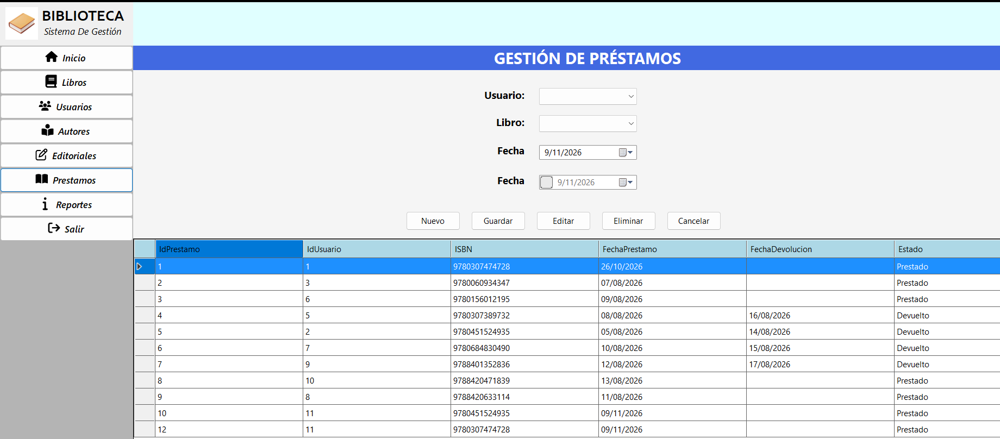
 
**Descripción:** Registro de préstamos, registro de devoluciones y eliminación de préstamos.
 
## 11.7 Reportes
 
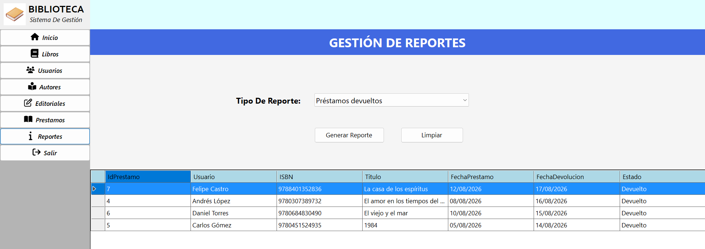
 
**Descripción:** Generación de los reportes de préstamos activos, préstamos devueltos e inventario de libros.
 
---
 
# 12. PRUEBAS DE FUNCIONAMIENTO
 
## 12.1 Estrategia de pruebas
 
Se realizaron pruebas funcionales manuales sobre la aplicación en ejecución, usando los datos de prueba cargados con `SQLQuery2.sql`. Cada prueba se ejecutó desde la interfaz y se verificó el mensaje mostrado y el estado de los datos (por ejemplo, las existencias del libro).
 
## 12.2 Casos de prueba
 
> NOTA: Los resultados se encuentran en la carpeta de Evidencias de GitHub.
 
| ID | Funcionalidad | Entrada / Acción | Resultado esperado | Resultado obtenido | Estado |
|---|---|---|---|---|---|
| CP01 | Registrar libro | Datos válidos con autor y editorial existentes | Mensaje «Libro guardado correctamente»; el libro aparece en el listado | | |
| CP02 | Registrar libro | ISBN ya existente | La base de datos rechaza el registro y se muestra un mensaje de error | | |
| CP03 | Registrar libro | Año o existencias no numéricos | Mensaje indicando que debe ser un número entero | | |
| CP04 | Buscar libro | ISBN existente / inexistente | Se cargan los datos / mensaje de que no se encontró | | |
| CP05 | Registrar usuario | Datos válidos | Mensaje «Usuario guardado correctamente» | | |
| CP06 | Registrar usuario | Documento repetido | La base de datos rechaza el registro y se muestra un mensaje de error | | |
| CP07 | Registrar préstamo | Usuario y libro con existencias | Préstamo en estado «Prestado» y existencias disminuidas en 1 | | |
| CP08 | Registrar préstamo | Libro con 0 existencias | Mensaje «No hay existencias disponibles de este libro»; no se crea el préstamo | | |
| CP09 | Registrar devolución | Préstamo «Prestado» con fecha válida | Estado «Devuelto», fecha guardada y existencias aumentadas en 1 | | |
| CP10 | Registrar devolución | Fecha anterior a la del préstamo | Mensaje de fecha inválida; no se modifica el préstamo | | |
| CP11 | Registrar devolución | Préstamo ya devuelto | Mensaje «Este préstamo ya fue devuelto» | | |
| CP12 | Eliminar préstamo | Préstamo «Prestado» | Préstamo eliminado y existencia repuesta | | |
| CP13 | Reportes | Préstamos activos, devueltos e inventario | Se muestran las tablas correspondientes | | |
 
## 12.3 Evidencias de pruebas
 
 
### Prueba CP01
 
 
### Prueba CP08
 
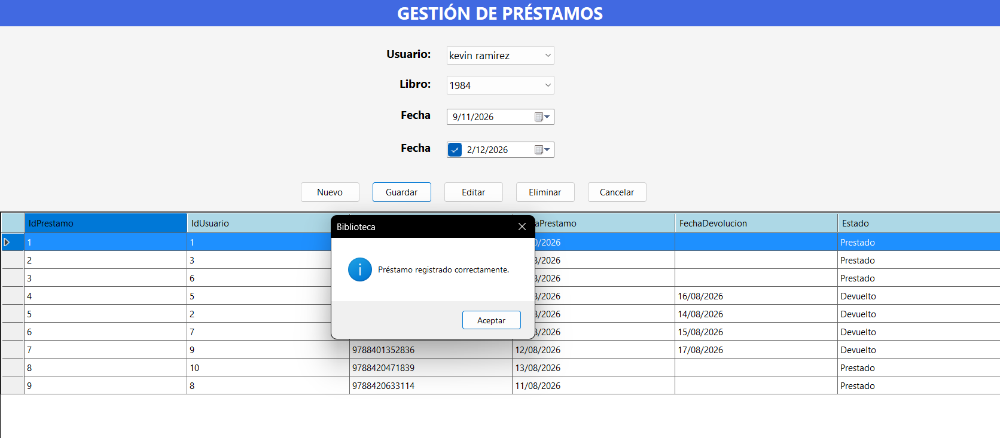
 
 
---
 
# 13. CONCLUSIONES
 
- Se desarrolló una aplicación de escritorio funcional en C# y Windows Forms que administra libros, autores, editoriales, usuarios y préstamos sobre una base de datos SQL Server, y que genera tres reportes de consulta.
- La aplicación de transacciones en los préstamos, devoluciones y eliminaciones permitió mantener las existencias de los libros consistentes con el estado de los préstamos.
- El diseño de la base de datos con claves primarias, claves foráneas y restricciones de unicidad, junto con las consultas parametrizadas y el manejo de excepciones, contribuyó a la integridad y seguridad de los datos.
- Durante el desarrollo se simplificó el modelo inicial (categorías, detalle de préstamo, devoluciones y multas) para ajustarlo a las necesidades reales del sistema, y la documentación se actualizó para reflejar exactamente lo implementado.
- _(Agregar las dificultades encontradas y cómo se resolvieron.)_
---
 
# 14. RECOMENDACIONES
 
- Separar la lógica de negocio y el acceso a datos en clases independientes (por ejemplo, controladores y DAO) para lograr una arquitectura por capas más estricta.
- Mover la cadena de conexión a un archivo de configuración para no depender del nombre del servidor en el código.
- Incorporar autenticación y roles de usuario.
- Agregar fechas límite de devolución, control de préstamos vencidos y multas, así como una entidad de categorías.
- Agregar pruebas automatizadas y un registro de errores (logs).
- Realizar copias de seguridad periódicas de la base de datos.
---
 
# ANEXOS
 
## Anexo A. Repositorio GitHub
 
**Repositorio:** https://github.com/kevin-krc/AcaBiblioteca
 
## Anexo B. Script de base de datos
 
**Archivo:** `SQLQuery2.sql` (creación de tablas y datos de prueba). También se entrega el respaldo `AcaBiblioteca.bak`.
 
## Anexo C. Evidencia de Git y GitHub
 
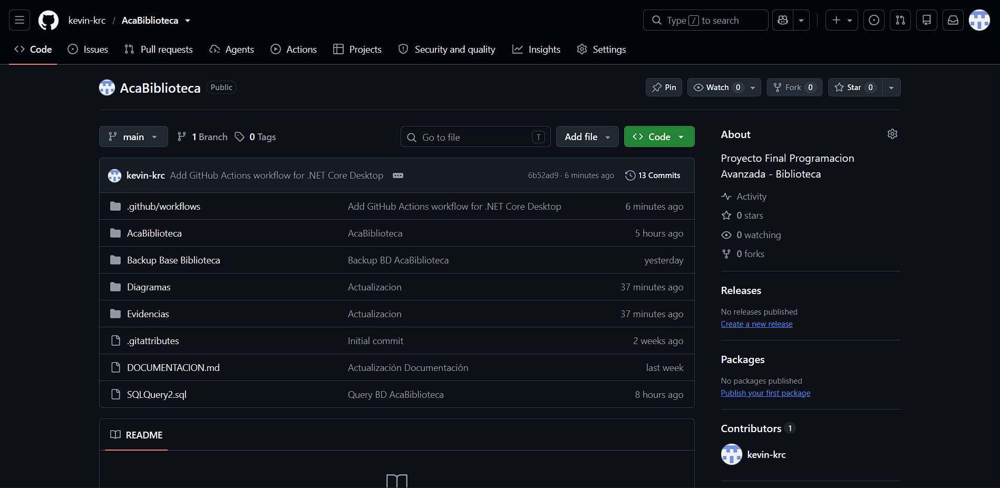
 

 